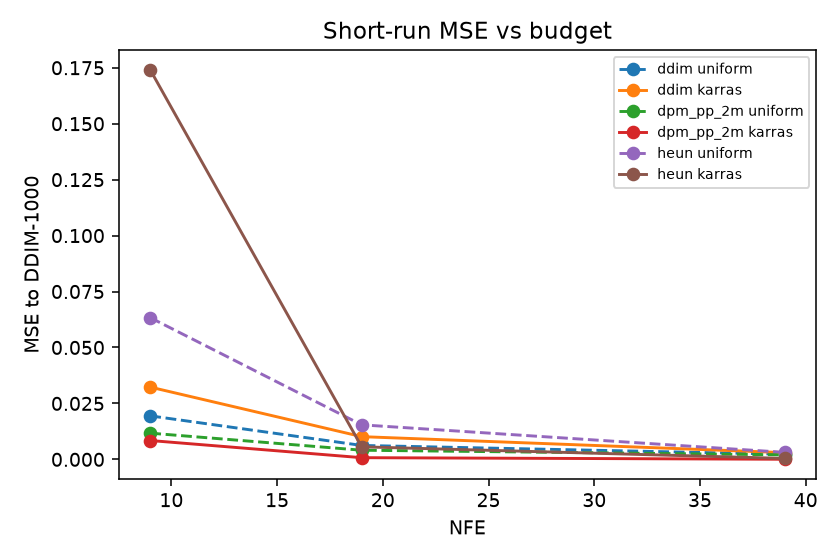
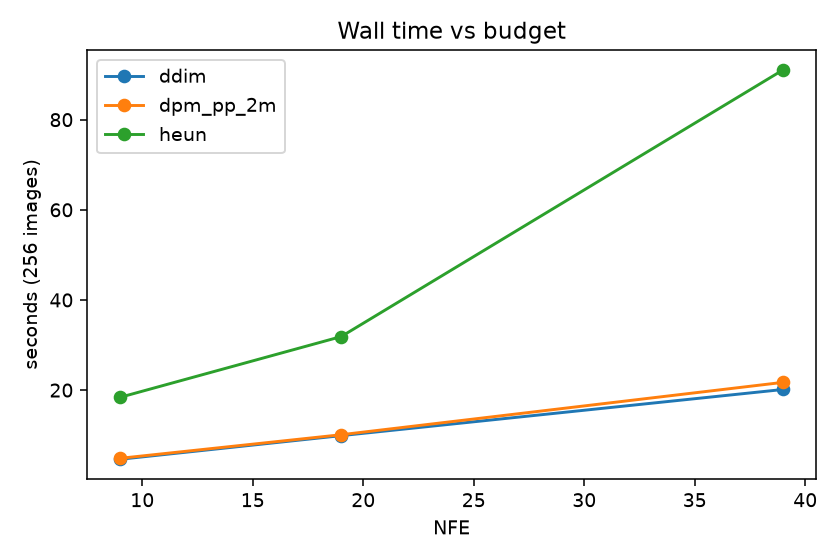
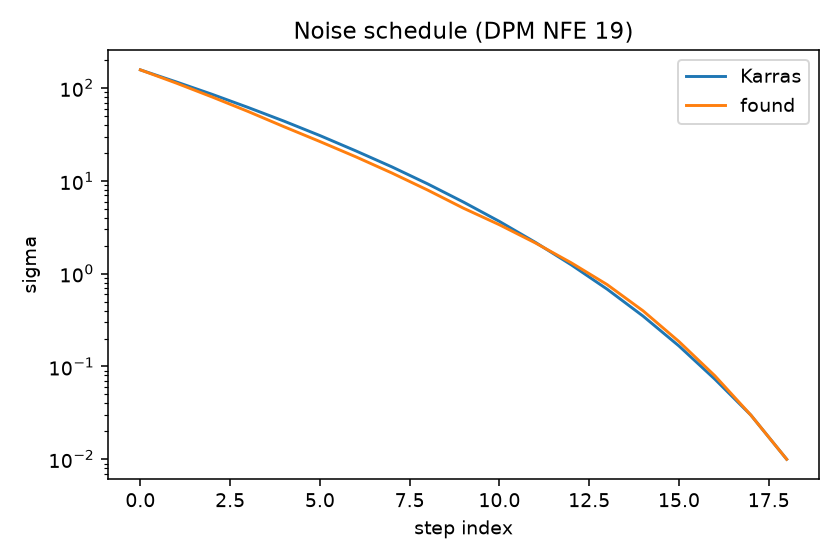
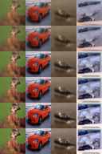

# Отчёт

**Курс:** генеративные модели для визуальных данных, МФТИ / VK Education  
**Тема:** разные методы генерации из диффузионных моделей  
**Модель:** `google/ddpm-cifar10-32`, CIFAR-10 32×32  
**Код:** собственные DDIM, DPM-Solver++ 2M и Heun (EDM) на PyTorch, сверка с Diffusers 0.32.2

PixArt-α в задании помечен как дополнительный вариант. После закрытия обязательного объёма на CIFAR-10 он не запускался.

---

## 1. Постановка

Замороженный U-Net предсказывает шум ε. Меняются только алгоритм перехода к следующему состоянию (сэмплер) и сетка уровней шума. Нужно:

1. Реализовать DDIM (η = 0), многошаговый DPM-Solver++ второго порядка и Heun по схеме EDM.
2. Сверить реализации с Diffusers.
3. Сравнить стандартные сетки при **одинаковом числе вызовов модели (NFE)**.
4. Подобрать уровни шума: сдвигать несколько опор, сохраняя порядок, и уменьшать отличие от длинной детерминированной генерации.
5. Подобрать сетку на фиксированном наборе шумов и проверить на новых.
6. Посмотреть, на каких участках траектории нужны более частые шаги и переносится ли правило между сэмплерами.
7. Оценить результат по MSE к длинной траектории, визуально, FID, NFE и времени; время поиска считать отдельно.

Это и есть обязательный объём. Ниже — как он закрыт.

| Требование | Где |
|---|---|
| Три своих сэмплера | `src/gencv/samplers/` |
| Сверка с Diffusers | §4, `outputs/s2_match_ddim.json` и аналоги |
| Сравнение сеток при том же NFE | §6.1, 18 конфигураций |
| Подбор опор с сохранением порядка | §3.6, §6.3 |
| Поиск на одних шумах, проверка на других | search 32 / valid 64 / mse_test 256 |
| Где нужны более частые шаги | контроли early / mid / late |
| Перенос правила между сэмплерами | found → DDIM и Heun |
| MSE к длинной детерминированной генерации | опора DDIM-1000 |
| Визуально, FID, NFE, время | §6.5–6.6 |
| CIFAR-10 + `google/ddpm-cifar10-32` | весь протокол |

---

## 2. Модель и протокол

Чекпоинт — DDPM, T = 1000, линейная β от 10⁻⁴ до 0.02, `prediction_type=epsilon`, `clip_sample=true` в конфиге. Обучения нет.

Два режима нельзя смешивать:

- **MATCH** — повторить выбранный scheduler Diffusers, включая clip `x̂₀` в `[-1, 1]`.
- **RESEARCH** — без внутреннего clip; `clamp[-1, 1]` только при сохранении PNG.

Сравнивается **NFE** (вызовы U-Net на одно изображение), не `num_inference_steps`. Heun делает два вызова на шаг и один Эйлер в конце, поэтому при K положительных уровнях NFE = 2K − 1. Бюджеты 9 / 19 / 39:

| NFE | DDIM / DPM, K | Heun, K |
|---:|---:|---:|
| 9 | 9 | 5 |
| 19 | 19 | 10 |
| 39 | 39 | 20 |

Общий стартовый шум `z ~ N(0, I)` хранится в координатах DDPM (x). В координаты EDM он переводится явно: `y = x √(1 + s²)`. Подавать один и тот же тензор в DDIM и Heun нельзя.

Банки шумов не пересекаются, seed 0:

| Набор | n | Назначение |
|---|---:|---|
| stability | 16 | устойчивость опоры 250 / 500 / 1000 |
| search | 32 | кандидаты сетки |
| valid | 64 | выбор лучшего кандидата |
| mse_test | 256 | итоговая MSE, один раз |
| fid | 2000 (из банка 5000) | FID |

После просмотра `mse_test` и `fid` сетку не трогали.

Опора `G_ref` — DDIM η = 0, 1000 NFE, RESEARCH. MSE считается по float-тензорам в `[-1, 1]` до PNG. Это близость к выбранному ориентиру, не к «истинному» x₀. На 16 stability-шумах расхождение длин мало: 250 vs 1000 = 6.7·10⁻⁵, 500 vs 1000 = 7.4·10⁻⁶.

---

## 3. Методы

Формулы с выводом — в [`methods.md`](methods.md). Здесь — то, что нужно для чтения результатов.

### 3.1. Координаты и denoiser

VP-таблица модели: `s_t = √((1 − ᾱ_t) / ᾱ_t)`. U-Net всегда вызывается в x с целочисленным t. Оценка чистого изображения в y:

```
D(y, s) = y − s · ε̂(y / √(1+s²), t(s))
```

При s = 0 сеть не вызывается. Счётчик NFE оборачивает только forward U-Net.

### 3.2. DDIM, η = 0

Один переход — один NFE, пара `(t, t')` задаётся явно:

```
x̂₀ = (x_t − √(1−ᾱ_t) ε̂) / √ᾱ_t
x_{t'} = √ᾱ_{t'} x̂₀ + √(1−ᾱ_{t'}) ε̂
```

У `DDIMScheduler.step` в Diffusers `prev_timestep` считается через фиксированный шаг `T / N`, поэтому нерегулярную сетку в `scheduler.timesteps` подставлять нельзя. Для MATCH берётся штатная leading-сетка, для RESEARCH — свои пары `(t, t')`.

### 3.3. Heun (EDM, S_churn = 0)

Работает в y. Predictor–corrector; последний переход к s = 0 — Эйлер, без деления на ноль:

```
d  = (y − D(y,s)) / s
yE = y + (s' − s) d
y' = yE                          если s' = 0
y' = y + (s' − s) (d + d') / 2   иначе, d' в точке (yE, s')
```

### 3.4. DPM-Solver++ 2M

Многошаговый метод 2-го порядка, midpoint, `algorithm_type=dpmsolver++`, `final_sigmas_type=zero`. Состояние в x. Первый шаг и переход к s = 0 — первого порядка; дальше используется предыдущий `x̂₀`. Это не Heun/EDM: `solver_type="heun"` внутри DPM-Solver — другой алгоритм.

### 3.5. Стандартные сетки

Обе заканчиваются переходом в 0.

- **Uniform** — равномерно по метке t, как leading DDIM.
- **Karras**, ρ = 7 — равномерно в шкале `s^{1/ρ}`, затем каждый уровень привязывается к ближайшей свободной метке t без повторов.

### 3.6. Подбор сетки

База — Karras, NFE 19, сэмплер DPM-Solver++ 2M. Три внутренние опоры на позициях 0.25 / 0.50 / 0.75 нормированного индекса. Сдвиги в `log s`, на краях 0. Между опорами сдвиг линейно интерполируется и умножает базу: `s ← s · exp(δ(u))`. Нулевые сдвиги воспроизводят Karras.

Поиск — координатный спуск, три прохода со шагами 0.20 / 0.10 / 0.05, на опору два знака. Кандидат отвергается, если ломается порядок, вылезает из диапазона или после привязки к t меняется число узлов. Критерий:

```
L(S) = mean_j || G_S(z_j) − G_ref(z_j) ||²
```

Перенос в DDIM и Heun — та же функция сдвигов, а не список из 19 меток. У Heun она считается в K = 10 точках.

Контроль: с тем же бюджетом сдвигается только ранняя, только средняя или только поздняя опора.

---

## 4. Реализация и сверка

Пакет `src/gencv/`. Сэмплеры не вызывают Diffusers в RESEARCH-цикле. MATCH-петли в `diffusers_loops.py` нужны только для численной сверки.

| Сэмплер | max abs | NFE | Файл |
|---|---|---|---|
| DDIM η = 0 | 0 (шаг и траектория) | — | `outputs/s2_match_ddim.json` |
| Heun EDM | 0 | 19 при K = 10 | `outputs/s4_match_heun.json` |
| DPM-Solver++ 2M | 2.0·10⁻⁶ | 20 | `outputs/s5_match_dpm.json` |

Допуски MATCH: шаг < 10⁻⁵, траектория < 10⁻⁴. Все 18 RESEARCH-конфигураций дают фактический NFE 9 / 19 / 39 (`outputs/s6_nfe.json`).

Окружение рабочего прогона: Apple M5 Pro, MPS, torch 2.14.1, diffusers 0.32.2, transformers 4.57.6. На MPS генератор `torch.Generator` для `randn` должен быть CPU.

---

## 5. Что запускалось

| Серия | Объём | Время |
|---|---|---|
| Опоры DDIM-1000 | 352 шума | 767 с |
| Поиск сетки + valid/controls | 19 кандидатов | 36 с (из них поиск 24 с) |
| MSE-таблица | 3 сэмплера × 2 сетки × 3 бюджета + перенос + контроли, 256 шумов | ~11 мин |
| FID | 6 конфигураций × 2000 картинок, NFE 19 | ~22 мин |

FID: clean-fid, статистика CIFAR-10 test 32×32. Генерация на MPS, Inception на CPU. Это не те 50k картинок, с которыми сравнивают статьи; числа ниже только для сравнения шести конфигураций между собой.

---

## 6. Результаты

### 6.1. Стандартные сетки, MSE к DDIM-1000

256 отложенных шумов. Полная таблица: `outputs/s8/mse_table.csv`.



MSE при NFE 19:

| | uniform | Karras |
|---|---:|---:|
| DDIM | **0.00622** | 0.01015 |
| DPM-Solver++ 2M | 0.00408 | **0.000751** |
| Heun | 0.01543 | 0.00560 |

Наблюдения:

- При том же NFE DPM-Solver++ 2M на Karras заметно ближе к длинной траектории, чем DDIM и Heun.
- Для DDIM равномерная сетка лучше Karras на всех трёх бюджетах.
- Для DPM и Heun лучше Karras, кроме Heun при NFE 9: там всего 5 положительных уровней, Karras даёт MSE 0.174 — худшая точка матрицы. К NFE 39 на Karras Heun догоняет (MSE 4.2·10⁻⁴).
- Порядок по MSE при NFE 19, Karras: DPM ≪ Heun < DDIM.

### 6.2. Время генерации



DDIM и DPM при одинаковом NFE почти совпадают по времени (~10 с на 256 картинок при NFE 19). Heun в 3× дороже: два вызова на шаг плюс перевод в y. NFE выравнивает число forwards, но не стоимость шага.

### 6.3. Найденная сетка и где нужны шаги

Сдвиги опор: `δ = (−0.15, −0.15, +0.15)`. Края фиксированы. В первой половине σ ниже, чем у Karras (быстрее уходим из сильного шума), ближе к чистому изображению σ выше — шаги там чаще.



- MSE на search 32: 2.85·10⁻⁴
- MSE на valid 64: 3.30·10⁻⁴
- 19 кандидатов, поиск 24 с

Одна опора на `mse_test` (NFE 19, DPM):

| Сетка | MSE |
|---|---:|
| Karras | 7.51·10⁻⁴ |
| только early | 6.98·10⁻⁴ |
| только late | 7.21·10⁻⁴ |
| только mid | 7.30·10⁻⁴ |
| все три опоры (found) | **6.53·10⁻⁴** |

Сдвиг любой одной опоры уже лучше базы, полный found лучше любой одной. Знак поздней опоры (+): полезно оставить больше шагов у слабого шума. Это согласуется с картинкой сетки. Разница между early / mid / late на тесте маленькая (~3·10⁻⁵), так что «нужнее конец» — слабый, но устойчивый эффект, а не смена режима.

### 6.4. Перенос правила

Та же функция сдвигов, NFE 19, `mse_test`:

| | Karras | found | Δ |
|---|---:|---:|---:|
| DPM-Solver++ 2M | 0.000751 | **0.000653** | −13 % |
| DDIM | 0.01015 | 0.00925 | −9 % |
| Heun | 0.00560 | 0.00543 | −3 % |

Правило переносится с тем же знаком. Выигрыш маленький и не меняет лидера: DPM + Karras уже был лучшим, found его слегка улучшает. Для Heun выигрыш почти на уровне шума оценки.

### 6.5. Визуально

Одинаковые 8 шумов, NFE 19. Слева направо: опора DDIM-1000, DDIM Karras, DPM Karras, Heun Karras.

**Опора DDIM-1000**


**DDIM Karras, NFE 19**


**DPM-Solver++ 2M Karras, NFE 19**


**Heun Karras, NFE 19**


При 19 вызовах DPM уже близок к опоре (машина, самолёт, корабль). DDIM на той же сетке мыльный: классы те же, детали нет. Heun ближе к DPM, чем к DDIM. Found vs Karras для DPM глазом почти не отличить:


Четыре худших случая found-DPM против опоры (индексы 159, 173, 123, 194). Там меняются цвет и иногда класс, не только зерно.

**Опора**


**DPM found, NFE 19**


Сводка 4 шумов × 3 сэмплера × {Karras, found}:



### 6.6. FID

2000 картинок, NFE 19, `outputs/s8/fid.json`.

| | Karras | found |
|---|---:|---:|
| DDIM | 40.15 | 39.33 |
| DPM-Solver++ 2M | **29.10** | **28.79** |
| Heun | 31.39 | 30.86 |

Тот же порядок, что у MSE: DPM лучше Heun, Heun лучше DDIM. Найденная сетка снижает FID у всех трёх на 0.3–0.8, без смены лидера. Совпадение знака с MSE здесь есть, но это не теорема: MSE меряет близость к DDIM-1000 при том же z, FID — расстояние распределений до CIFAR-10 test.

---

## 7. Выводы

1. Свои DDIM, Heun и DPM-Solver++ 2M совпадают с Diffusers в пределах допуска (для DDIM и Heun — побитово в fp32 на проверенных траекториях).
2. При фиксированном NFE главный выигрыш даёт **выбор сэмплера и стандартной сетки**, а не локальный поиск. DPM-Solver++ 2M + Karras — лучшая точка обязательной матрицы и по MSE, и по FID.
3. Uniform vs Karras зависит от сэмплера: DDIM лучше на равномерной сетке по t, DPM и Heun — на Karras, кроме вырожденного Heun при NFE 9.
4. Координатный спуск трёх опор работает, дешёвый (полминуты) и переносится на DDIM и Heun с тем же знаком. Эффект небольшой (−13 % MSE у DPM, −0.3 FID). Имеет смысл как уточнение, не как замена Karras.
5. Шагов чуть не хватает ближе к чистому изображению: поздняя опора сдвигается вверх по σ, полная тройка опор лучше любой одной.
6. NFE выравнивает число вызовов, но не стену времени: Heun при том же NFE в несколько раз медленнее из-за корректора.

---

## 8. Ограничения

- FID на 2000 картинках, не на 50k. Сравнивать с таблицами статей нельзя.
- Опора — DDIM-1000, не аналитический x₀. Для бюджетов 19–39 это достаточно (стабильность 250/500/1000), но MSE оптимизирует согласованность с конкретным длинным DDIM, а не FID.
- Поиск только относительно Karras и только для DPM при NFE 19. Другой старт (uniform) не смотрели.
- PixArt-α не делался.
- Inception для FID считался на CPU (на машине нет CUDA). Для сравнения шести папок это воспроизводимо, абсолютные FID могут чуть отличаться от CUDA-прогона clean-fid.

---

## 9. Как воспроизвести

Установка и команды — в корневом [`README.md`](../README.md). Демо без полного пайплайна:

```bash
python scripts/s9_demo.py
```

Нужны `data/schedules/found.yaml` и веса модели с Hugging Face.

Числа в этом отчёте ссылаются на файлы:

| Что | Файл |
|---|---|
| MATCH | `outputs/s2_match_ddim.json`, `s4_match_heun.json`, `s5_match_dpm.json` |
| NFE | `outputs/s6_nfe.json` |
| Опоры | `outputs/s7_references.json` |
| Поиск | `data/schedules/found.yaml`, `outputs/s7_search.json` |
| MSE | `outputs/s8/mse_table.csv` |
| FID | `outputs/s8/fid.json` |

---

## Литература

1. J. Ho, A. Jain, P. Abbeel. Denoising Diffusion Probabilistic Models. NeurIPS 2020.
2. J. Song, C. Meng, S. Ermon. Denoising Diffusion Implicit Models. ICLR 2021.
3. T. Karras, M. Aittala, T. Aila, S. Laine. Elucidating the Design Space of Diffusion-Based Generative Models. NeurIPS 2022.
4. C. Lu et al. DPM-Solver++: Fast Solver for Guided Sampling of Diffusion Probabilistic Models. 2022.
5. Hugging Face Diffusers, `DDIMScheduler` / `HeunDiscreteScheduler` / `DPMSolverMultistepScheduler`, v0.32.2.
6. `google/ddpm-cifar10-32`. Hugging Face.
